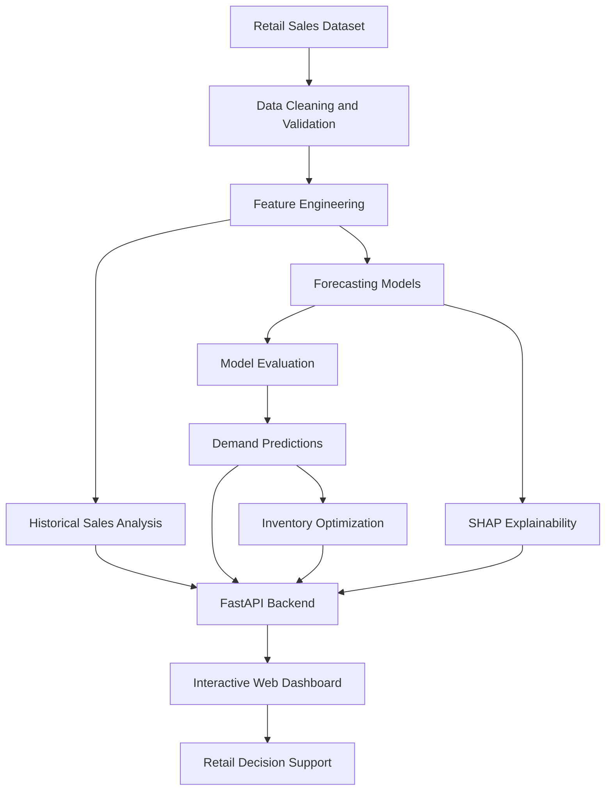

# RetailPulse AI — Demand Forecasting & Inventory Optimization

An AI-powered retail analytics platform that combines machine learning, demand forecasting, inventory optimization, and interactive visualizations to support data-driven retail decisions.

---

## Table of Contents

- [Overview](#overview)
- [Key Features](#key-features)
- [Technology Stack](#technology-stack)
- [System Architecture](#system-architecture)
- [Dataset](#dataset)
- [Machine Learning Models](#machine-learning-models)
- [Model Evaluation](#model-evaluation)
- [Inventory Optimization](#inventory-optimization)
- [Explainable AI](#explainable-ai)
- [Getting Started](#getting-started)
- [Running the Application](#running-the-application)
- [Project Structure](#project-structure)

---

## Overview

RetailPulse AI is a machine learning-based decision-support platform designed to help retailers analyze historical sales, forecast future demand, and make informed inventory planning decisions.

Retail businesses often face challenges such as unpredictable demand, excess inventory, stockouts, and inefficient replenishment planning. RetailPulse AI addresses these challenges by combining historical sales analytics, predictive modeling, inventory calculations, and interactive dashboards in one application.

The platform processes retail sales data, generates forecasts at the weekly product sub-category level, and uses configurable inventory parameters to support replenishment decisions.

### Project Objectives

- Analyze historical retail sales and demand patterns.
- Develop and compare machine learning forecasting models.
- Generate future demand estimates.
- Support inventory planning and replenishment decisions.
- Visualize sales trends and forecasting results.
- Improve model transparency through explainable AI.
- Expose application functionality through a REST API.

---

## Key Features

### Demand Forecasting

- Forecast future demand from historical sales data.
- Compare machine learning models with baseline forecasting approaches.
- Support configurable forecasting horizons.
- Visualize historical and predicted demand.
- Analyze demand patterns across product sub-categories.

### Inventory Optimization

- Estimate reorder points and safety stock.
- Calculate suggested replenishment quantities.
- Support configurable supplier lead times and service levels.
- Account for minimum order quantities and case-pack constraints.
- Estimate economic order quantities using configurable cost assumptions.

### Sales Analytics

- Analyze historical retail sales performance.
- Explore demand trends over time.
- Compare product and sub-category performance.
- Present insights using interactive charts and visualizations.

### Product Catalog

- Browse product information and categories.
- Organize product data for analytical workflows.
- Connect product information with sales and forecasting views.

### Inventory Alerts

- Highlight inventory conditions requiring attention.
- Support replenishment planning.
- Identify potential inventory risks based on configured parameters.

### Explainable AI

- Use SHAP-based analysis to investigate feature contributions.
- Help users understand which input features influence model predictions.
- Support interpretation of forecasting behavior.

### REST API

- Provide backend functionality through FastAPI.
- Validate supported inputs using Pydantic.
- Generate interactive API documentation.
- Connect the backend with the web dashboard.

---

## Technology Stack

| Component | Technologies |
|---|---|
| Programming Language | Python |
| Data Processing | Pandas, NumPy |
| Machine Learning | Scikit-learn, XGBoost |
| Explainable AI | SHAP |
| Backend Framework | FastAPI |
| ASGI Server | Uvicorn |
| Frontend | HTML5, CSS3, JavaScript |
| Data Visualization | Chart.js |
| API Validation | Pydantic |
| Data Interoperability | PyArrow |
| Testing | Pytest |
| Version Control | Git, GitHub |

---

## System Architecture



### Workflow

1. Load the retail sales dataset.
2. Validate and clean the data.
3. Process dates and prepare historical demand observations.
4. Aggregate data into weekly product sub-category time series.
5. Generate features for forecasting.
6. Train and evaluate candidate forecasting models.
7. Generate demand predictions.
8. Apply inventory planning calculations using forecasts and configuration inputs.
9. Serve results through the API and web dashboard.

---

## Dataset

The project uses the following dataset:

`india_retail_sales_dataset.csv`

The project documentation reports the following dataset characteristics. Verify these values against the actual dataset and preprocessing pipeline before using them as final research results.

| Attribute | Reported Value |
|---|---:|
| Raw rows | 10,009 |
| Raw columns | 24 |
| Rows after duplicate removal | 9,994 |
| Duplicate Order IDs removed | 15 |
| Reported date range | January 1, 2023 – December 31, 2025 |
| Product sub-categories | 20 |
| Distinct product names | 74 |
| Weekly time-series rows | 3,160 |

### Data Preprocessing

The documented workflow includes:

- Data cleaning and validation.
- Duplicate identification and removal.
- Date parsing and time-based aggregation.
- Weekly demand-series construction.
- Feature engineering for forecasting.
- Chronological separation of training, validation, and test datasets.

### Forecasting Granularity

The documented forecasting dataset contains 20 product sub-categories across 158 weekly periods.

Therefore, the forecasting model operates at the **weekly product sub-category level**, rather than independently forecasting demand for every individual SKU.

---

## Machine Learning Models

RetailPulse AI evaluates multiple forecasting approaches to compare predictive performance.

| Model | Description |
|---|---|
| Naive Forecast | Uses a recent observed value as a baseline |
| Seasonal Naive | Uses a previous seasonal observation |
| Moving Average | Smooths historical demand fluctuations |
| Ridge Regression | Applies regularized linear regression |
| Random Forest | Uses an ensemble of decision trees |
| XGBoost | Uses gradient-boosted decision trees |

---

## Model Evaluation

The following results are reported in the project documentation and have not been independently verified in this README.

### Validation Results

| Model | MAE |
|---|---:|
| XGBoost | 3.1816 |
| Random Forest | 3.2242 |
| Ridge Regression | 3.2311 |

### Test Results

| Model | MAE | RMSE | WAPE |
|---|---:|---:|---:|
| Ridge Regression | 3.1943 | 3.8320 | 55.49% |
| XGBoost | 3.3267 | 3.9726 | 57.79% |
| Random Forest | 3.3594 | Not reported | 58.36% |

---

## Inventory Optimization

RetailPulse AI combines forecast demand with configurable operational parameters to support inventory planning.

### Reorder Point

A basic reorder point can be calculated as:

```text
Reorder Point = Expected Demand During Lead Time + Safety Stock
```

### Safety Stock

A simplified statistical formulation is:

```text
Safety Stock = Z × Demand Standard Deviation × √Lead Time
```

Where:

- `Z` represents the service-level factor.
- `Demand Standard Deviation` represents demand variability per time period.
- `Lead Time` is expressed in the same time units used for the demand variability estimate.

This simplified formulation assumes a consistent lead time and an appropriate estimate of demand variability.

### Economic Order Quantity

The standard EOQ formula is:

```text
EOQ = √((2 × Annual Demand × Ordering Cost) / Annual Holding Cost per Unit)
```

### Inventory Parameters

Inventory calculations may use:

- Current stock.
- Forecast demand.
- Supplier lead time.
- Target service level.
- Minimum order quantity.
- Case-pack quantity.
- Ordering cost.
- Holding cost.

---

## Getting Started

### Prerequisites

Install the following:

- Python 3.12, recommended for this project environment.
- pip.
- Git.
- PowerShell, Command Prompt, or another terminal.

### 1. Clone the Repository

```bash
git clone https://github.com/prajwal-mhase/RetailPulse-AI
cd RetailPulse-AI
```

### 2. Create a Virtual Environment

**Windows PowerShell**

```powershell
python -m venv .venv
.\.venv\Scripts\Activate.ps1
```

**macOS / Linux**

```bash
python3 -m venv .venv
source .venv/bin/activate
```

### 3. Install Dependencies

Run the following command from the project root:

```bash
python -m pip install --upgrade pip
python -m pip install -r requirements.txt
```

The `requirements.txt` file contains the project's Python dependency specifications.

---

## Running the Application

### Start the FastAPI Server

From the project root, with the virtual environment activated, run:

```bash
python -m uvicorn api:app --host 127.0.0.1 --port 8000
```

After the server starts successfully, open the following URLs.

| Resource | URL |
|---|---|
| Main Dashboard | http://127.0.0.1:8000/ |
| Interactive API Documentation | http://127.0.0.1:8000/docs |
| Alternative API Documentation | http://127.0.0.1:8000/redoc |

To stop the server, press `Ctrl + C`.

---

## Project Structure

The following is an illustrative structure. Directory names and file locations may differ in the actual repository.

```text
RetailPulse-AI/
├── api.py
├── requirements.txt
├── india_retail_sales_dataset.csv
├── README.md
├── .gitignore
├── frontend/
│   ├── HTML files
│   ├── CSS files
│   └── JavaScript files
├── models/
├── data/
└── configuration/
```

---

## Project Summary

RetailPulse AI demonstrates an end-to-end approach to retail demand forecasting and inventory decision support by integrating data processing, machine learning, model explainability, inventory calculations, REST APIs, and interactive visualizations.

The platform aims to transform historical retail sales data into actionable insights while making model assumptions, evaluation results, and limitations transparent.

**Built with Python, machine learning, FastAPI, and data visualization.**

---
